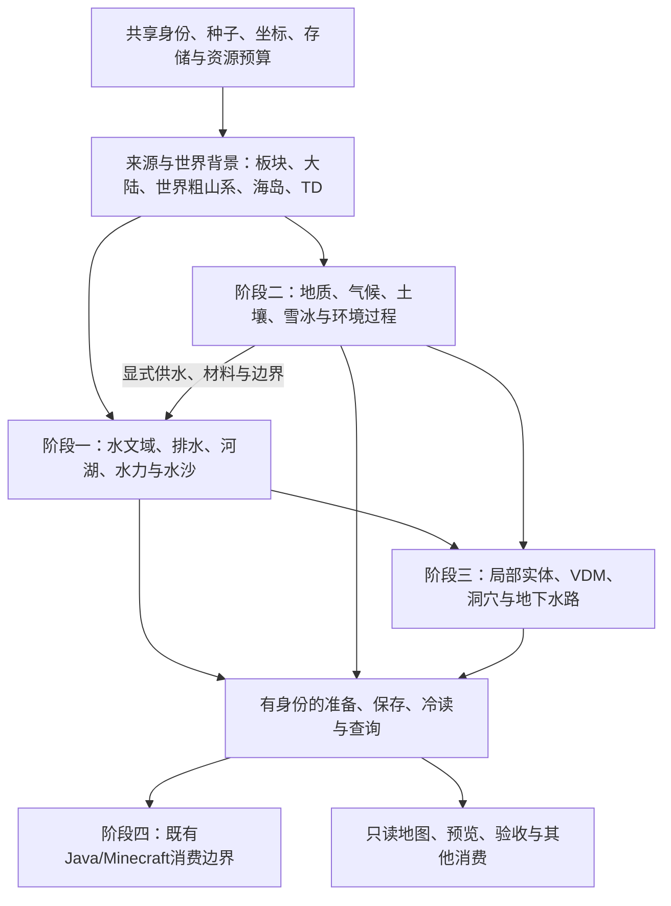

# 世界生成系统模块总览

日期：2026-11-07。此目录将当前活跃模块统一归入一个世界生成系统，只做逻辑分类。模块代码、物理目录、import、算法参数、种子、旧产物和默认消费者均不改变。

本次覆盖 **1703 个源码/支持文件**，其中 **337 个Python算法/IO模块**；额外登记 **40 个配置/资源清单**。每个文件有且只有一个主归属，可以关联多个细项；四阶段表的关联数不可相加当作独立模块数。

## 系统如何组成

箭头表示目标职责与已有适配方向；不是所有箭头均已在同一保存世界中通过联合验收。当前主方向为大陆基底→世界粗山系→TD局部山地，独立山体与局部地貌试验按真实来源作为可选能力保留。

## 四阶段分类

| 层次 | 细分 | 文件 |
| --- | --- | --- |
| 第一阶段：无限世界河网 | R1–R9，沿用原规划标题 | [阶段一](stage-1.md) |
| 第二阶段：地理环境及地表表现 | G1–G20，保留有限实现和暂停边界 | [阶段二](stage-2.md) |
| 第三阶段：非高度场三维地貌 | V1–V8，区分表示、形态、水路与消费 | [阶段三](stage-3.md) |
| 第四阶段：Java/Minecraft消费 | J1–J6 为本轮新增导航分类 | [阶段四](stage-4.md) |
| 共享契约与编排 | X1身份/坐标/存储、X2资源/调度、X3只读展示 | [共享能力](shared.md) |
| 工程支持 | X4构建/测试/维护；工具和测试按直接owner挂接细项 | [支持文件](support.md) |
| 配置与资源 | Mod资源、依赖、安装清单和历史边界 | [资源与外部依赖](resources.md) |

[逐文件机器目录](modules.json)记录主归属、关联细项、职责依据、角色、适用边界和当前源码SHA；[原大类目录](../module-catalog/README.md)保留A/B/B1/B2/C/D/infra视角，并同步本轮stage标签。大类与四阶段是两条轴，不能将C类水力一律归三维阶段。

## 分类与可用性的边界

- 当前文件存在且具备实际职责，才纳入活跃模块表；核心owner按公开职责和合并来源审阅，工具/测试以直接导入挂接。仅维护支撑者保留X4，不伪造科学子项。
- 多职责owner只登记一次，例如 `soil_water` 同时覆盖G5/G6/G7/G9与R5；`environment_processes`登记G9–G20中的有限机制；`special_terrain`覆盖多种三维形态。
- 各模块的“可用”指在原契约范围内可作为生成系统能力或支持组件选择。原型、候选、诊断、兼容、离线工具与消费端单列；分类不新增默认接线，不授予开发权限，也不将有限产品升级成完整无限世界认证。
- 独立交付的海岛、山体、环境、河网、三角洲与三维原型保留其来源/身份和原验收限制。完整世界的稳定归属、跨域水文、长期自然形态、全三维联合消费与默认Java接线仍按现有任务逐项验收。G17后续袭夺开发保持暂停。
- J1–J6只是第四阶段的文档导航，不是旧规划已有编号；既有Java地形/侵蚀/水文代码登记为兼容职责，不据此改变“前三阶段Python、第四阶段转换消费”的目标。

## 来源与维护

依据：[四阶段主线](../../terrain-diffusion-four-stage-roadmap.md)、[R/G/V详细组成审阅稿](../../../.scratch/terrain-four-stage-review-20261021/algorithm-components-review.md)、[有界规划ADR](../../adr/0001-bounded-hydrological-planning.md)、[工程实现说明](../implementation-guide.md)。旧日期的未实现/部分实现标签不覆盖其后实际交付；本次分类不重写完成度。

分类生成规则与手工owner覆盖位于[本轮记录](../../../.scratch/world-system-classification-20261107/spec.md)及同目录 `classify_world.py`；原大类登记在 `algorithm-categories.json`，stage登记在 `module-catalog/annotations.json`。源码新增后应显式补分类，不把自动文件名推测当作运行证据。清理结果单独见[data-cleanup.md](data-cleanup.md)。
