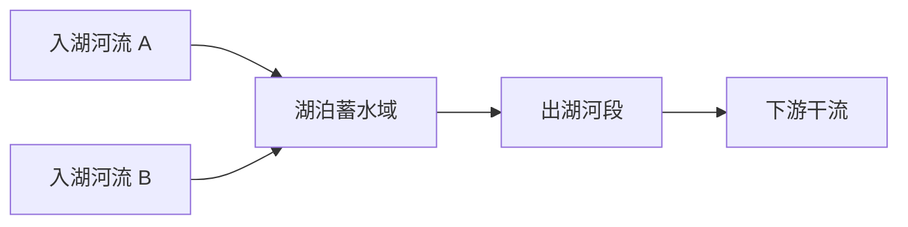

# 湖泊连接与河网泥沙复用评估

日期：2026-10-16。依据当前代码和实际运行的河湖测试；能力核查不等于真实鄱阳湖案例验收。

## 湖泊能否同时是河段终点和起点

可以。湖泊应当是独立的蓄水域：入湖河段在端口结束，出湖河段从另一个端口开始。出湖水来自湖泊库存与入流，不能再凭空计为新的水源。

| 需求 | 当前实际能力 | 限制 |
| --- | --- | --- |
| 河流入湖，再流入另一河段 | `metric_boundary_coupling.solve_coupled` 已支持；`channel_to_lake` 接收入湖水，`LakeOutlet.receiver` 可指向下游河节点、另一湖或外排 | 简化蓄水和出口关系；未证明所有生成河网均已自动绑定湖泊几何 |
| 河湖水位差改变交换方向 | `metric_lake_channel_coupling.solve_lake_channel` 的 `LakeChannelPort` 有符号交换已支持，正为河入湖，负为湖出河 | 端口必须接 `receiver[node] == -1` 的河段末端；负流注入末端后没有一般下游 receiver 可继续传播 |
| 鄱阳湖式干流侧接、顶托、倒灌后继续向干流下游传水 | 具有部分端口反流基础 | 完整侧接节点、回水水动力与全网传播尚未接通；不能用“两个末端端口”宣称已完整实现 |
| 湖内沉积、再悬浮、出湖输沙与库容变化 | 可复用有限泥沙库存和收支框架 | 尚未与湖泊蓄水及逐端口泥沙交换统一求解 |

已实际运行并通过三项测试：

- `tests.test_metric_boundary_coupling.CouplingTests.test_river_lake_river_transfer_is_counted_once`：河→湖→河的水量只记一次。
- `tests.test_metric_lake_channel_coupling.LakeChannelTests.test_two_basins_channel_port_and_independent_water_balance`：河湖及两湖各自守恒。
- `tests.test_metric_lake_channel_coupling.LakeChannelTests.test_reverse_port_and_free_outlet_direction`：允许反向端口交换；它并不证明干流侧接后的下游传播。

## 河网泥沙算法可用于哪里

公共部分是有限松散层与岩床侵蚀、实际流量携沙、输沙能力变化、沉降、再搬运及固体体积账。沉积位置必须由局部水流和地形决定，不能在每个汇合处固定铺一层泥。

| 场景 | 可复用内容 | 接入时仍需解决 |
| --- | --- | --- |
| 入湖口三角洲 | 上游供沙、流量分散与沉积、有限覆盖层再侵蚀 | 用湖水位替代海面边界；记录湖内库存、出口输沙及湖盆库容变化 |
| 河道汇流处 | 多支流的水沙混合与统一库存账 | 汇合处水位、宽深、动量与输沙能力；汇流可能冲刷，不能预设必然堆积 |
| 山口冲积扇、坡降突变 | 携沙能力下降与分散沉积 | 扇面可达路径和多出口分流；当前算法不等于泥石流模型 |
| 宽谷、洪泛平原和回水区 | 漫溢后沉积、覆盖层再搬运 | 岸高、漫溢连通、淹水时长、退水返流；当前正常水深闭合不能替代回水求解 |
| 沙洲、心滩、辫状河 | 沉积抬床与后续冲刷的反馈 | 多支分流和流量分配；单 receiver 图不能表达真正的多支分汊 |
| 出湖河道 | 使用实际出湖泥沙量计算下游侵蚀和沉积 | 湖泊拦沙后清水可能增强冲刷；不能照搬入湖浓度 |
| 内陆闭合盆地 | 有限入沙与盆地库存 | 闭合水量、蒸发和水位变化；不能套用海洋外排边界 |
| 水库淤积 | 入沙、沉降、库容损失及出口泥沙账 | 坝与调度出流、泄沙和清淤规则属于后续专门接口 |

建议接入顺序为湖泊泥沙账与入湖口，其次汇流及宽谷，再处理分汊改道。河流袭夺需要不同水文域间的拓扑更新与水沙交接，保留在第二阶段；本轮三角洲结果不代表已经实现袭夺。
