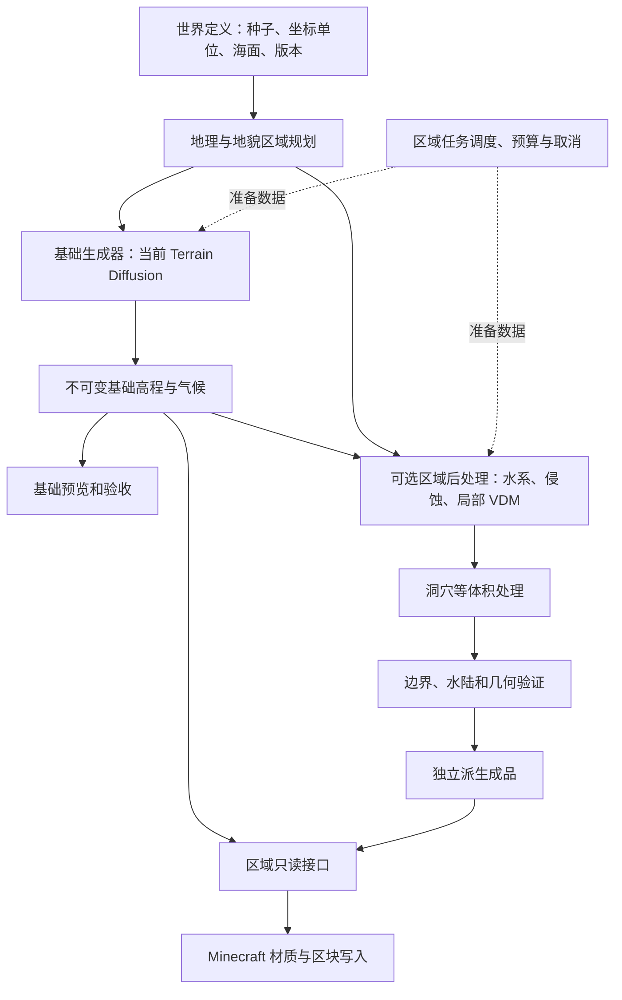

# Terragenesis 工程框架审查

审查日期：2026-09-28。范围：当前源码、用户实例已有日志与缓存路径。此文区分旧版行为和正在收拢的原始扩散模式，不代表 0.12.0 已通过游戏验收。

后续用户决定：取消新默认路线中的整体三倍放大，改为调整模型生成条件和参数。海面 Y=62、世界上限 1024、主要高山 Y=700–800 作为目标；实际是否达到需真实推理验证。基础模型结果继续单独保存，后处理仍独立。下文“新 raw 沿用旧尺度”等描述是审查时发现的问题，目前正在修订，不能当作修订后的最终设计。

随后用户进一步明确：旧地形测试世界全部清理，兼容迁移等稳定版本再做。已删除指定游戏实例的六个带编号地形测试存档，按用户要求保留不带编号的僵尸军团存档。因此下文保留旧契约/适配层的建议暂缓实施；已有实验代码可保留作对照，但不再作为当前架构的兼容要求。

## 结论

当前有真实 Terrain Diffusion 基础、VDM、区域持久化、洞穴、水文和 Minecraft 适配模块，但它们没有形成一条职责清晰、可逐阶段验收的数据流水线。主要矛盾不是算法数量不足，而是坐标换算、地貌归属、加工阶段和运行时生成混在一起。

现有模块可保留；先固定数据契约与阶段边界，避免边排查边加入更多地貌。新默认模式先验收原始扩散输出，之后加工为独立派生版本。

## 实际数据流

Python：种子与绝对坐标 → 随机地理条件 → Terrain Diffusion → 米制高程与气候 → `.npz` 原始缓存 → HTTP 瓦片。

旧 Java 区域模式：HTTP → 高程换算和 tanh 压缩 → 基础采样与另一套地貌标签 → 默认悬崖/侵蚀 → XYZ VDM → `.rmr` → 三倍世界映射与网格体素化 → 运行时洞穴扣除 → 材质/水 → Minecraft 区块。

注意：区域旧路径把世界尺度映射放在网格采样阶段；它不是单纯在模型输出后依次调用几个滤镜。有限山海流域还有单独的山海轮廓和预设河网，因此不能把所有模式都解释为仅在实时扩散地形上添加少量细节。

本轮新增原始模式：同一 Python 原始缓存 → 无 tanh 的高程换算 → 独立 `.rmraw` → 海面基准换为 Y=62 → 方块。绕过 VDM 和洞穴，但仍复用旧的部分尺度及材质配置，属于过渡实现。

## 已确认的问题

### 1. 数据读取接口会触发完整生成

- `core/BaseTerrainSource.java` 的 `sample` 同时用于模型基础、处理后的 VDM 和区域读取；调用方无法从接口分辨阶段或判断是否会启动服务。
- `region/RegionTerrainSource.java` 的缺失缓存分支会创建模型、构建悬崖和区域文件，采样时还做网格体素化。
- `world/TerrainBiomeSource.java` 第 30 行通过完整 `Terrain.sample` 查询群系。

影响：查群系也可能触发模型推理和区域加工；“Minecraft 只读已完成数据”尚未成立。建议分离区域准备任务、只读成品接口、轻量群系/气候字段接口。按需生成仍可保留，但由明确的任务调度入口负责，不能藏在普通查询函数中。

### 2. 原始数据与派生数据没有统一依赖关系

- Python `.npz` 已保存真实原始高程，这是应保留的基础。
- 旧 `.rmr` 中所谓基础高度已经过 Java tanh，且准备时强制加入 `RegionalCliffModifier`。
- 新 `.rmraw` 与旧 `.rmr` 已分目录，但旧加工器并不以 `.rmraw` 为必需父产物。
- `Terrain.solid` 在读取旧成品后继续执行洞穴算法，因此 `.rmr` 并非最终几何结果。

影响：不能仅凭一个区域文件重现全部最终几何；关闭/开启某项加工也缺少统一的前后版本链。建议基础文件不可变；每份派生成品保存基础摘要、坐标契约、步骤及参数版本。洞穴也必须成为显式阶段，或保存完整、版本化的体积场规则。

### 3. 坐标、海平面、限高和放大倍率绑在一起

- `core/TerrainScale.java` 把倍率、世界高度边界和海面捆绑；海面取决于 `factor==1`。
- `vdm/VectorDisplacementMap.java` 再次实现 72/62 和水上三倍、水下一倍的规则。
- `region/RegionTerrainSource.java` 硬编码 `/3` 与 `.scaled(3)`；`RegionConfig` 要求区块数是 3 的倍数。
- 新 raw 模式仍携带 `relief_3x_sea62_1024_v1`，却绕过三倍地形变换；`SurfacePalette` 仍读取该倍率决定土层厚度和岩层坐标。

影响：相同配置名在不同模式中含义不同；修改限高可能意外改变尺寸或材质。建议独立定义模型采样间距、物理单位、水平映射、竖向映射、海面和世界高度范围。只在一个转换入口做换算，其余模块使用声明好的坐标系。旧存档保留旧契约。

当前原始模式仍用模型 30 米高程对应 1 方块、1 像素对应 2 方块的固定比例；这不是物理等比例重建。不应为了达到 Y=700–800 而逐区域归一化，否则会改变轮廓关系并制造边界差异。

### 4. 地貌标签与真正塑形使用不同布局

- `region/RegionArtifact.java` 第 44 行使用 `RegionLandformLayout` 保存地貌标签。
- `cliff/RegionalCliffLayout.java` 使用旧 `core/Regions` 确定崖壁位置和类型。
- `RegionLandformLayout` 的过渡权重目前没有驱动这些塑形步骤。
- `DiffusionTerrainSource` 的地貌标签也来自 Java `Regions`，并非模型识别的地貌。

影响：显示为喀斯特的区域不保证有相应基础形状，材料/洞穴倾向与崖壁布局也可能错位。建议只保留一个权威地貌区域规划，明确“意图标签”和“实际生成形状”的区别。存储矩形与随机形状的地貌区域继续分离，这个方向是正确的。

### 5. 水文先于最终几何确定，缺少最终闭环

- `watershed/WatershedTerrainSource.java` 在基础高度图上确定河面、开挖河床；`GeneratedVdmSource` 随后继续添加崖壁。
- `GeneratedVdmSource.sample` 分别取得最终网格顶面与基础水位，没有通用的最终水陆约束校正阶段。
- 流域示例使用 `MountainRelief`、有限山海轮廓和预设 `DrainageGraph`；它不是完整的全域扩散地形自动汇流系统。

影响：局部河岸检查通过，并不证明后续加工后仍无悬水；既有 TODO 已记录汇流处问题。建议先形成连通河网约束，再加工河床与岸壁，最后对完整几何复核水位、河岸和出口。水沙台账守恒不能替代几何验收。

### 6. VDM 与体积拓扑必须分工

当前 VDM 是从参考平面位移得到的网格，体素化保留多重竖向交点，适合倾斜、折叠和部分悬挑。`CaveModel` 则用三维噪声另行扣除洞穴。这种表示分工有价值，但目前被隐藏在运行时 `solid` 中。

建议高度图用于基础与大尺度地表处理，VDM/局部面片用于崖壁与悬挑，洞穴贯通与新孔洞用体积场或体积操作。无需把所有平地都强制转换成 VDM；普通单值地表可直接按高度导入。

### 7. 区块任务完成契约与插件调用方不一致

用户日志记录 `remote-terrain-*` 与 Distant Horizons 放置矿物同时写同一方块容器。已检查 DH 3.3.2 的调用方式：调用 `buildTerrain` 后丢弃 future。旧生成器在 future 回调内写区块，因此它返回时方块可能尚未完成。

当前修复改为等待地形数据就绪，再在调用线程完成方块写入后返回已完成 future。它针对这个竞态，但可能阻塞调用线程，不能替代区域提前准备/任务取消/整体资源预算，也不能据此宣称所有 DH 兼容问题已解决。

### 8. 模式与流程定义分散

新增模式需要同步 `LandformMode`、`RemoteGenerator` 的两个允许列表与兼容判断、`Terrain.wrappedSource`、`TerrainSources`、`GeneratedVdmSource`、预检以及资源生成脚本。`vdm_recipe` 又承担整个流水线版本的职责，raw 模式也使用这个名称。

建议一个流水线定义表描述基础来源、转换契约、加工步骤、缓存版本和能力，UI、保存配置与预检从同一份定义导出。基础生成器只输出基础场，Minecraft 适配器只负责读取、材质映射和写块。

### 9. 缓存预算和界面语义仍需补齐

- raw 区域按每个 Minecraft 方块保存高度、水、气候和标签，最大 96×96 区块时单区约 78 MB，生成时还存在序列化副本；局部缓存限额不等于整个 JVM 与 Python 的总预算。应优先保留模型原生网格，按需插值，并统一管理内存、磁盘与预取队列。
- `LandformMode.of` 将未匹配模式回退为 RAW，打开设置时可能显示不准确。旧配方或未知组合应明确标注，并保留其值，不能悄悄冒充默认模式。
- 区域模式的预检仅保证安装完成，服务仍可能在首次实际生成时启动。这符合后续按需启动的目标，但界面应区分“已安装”“服务运行中”“区域数据已就绪”，不把三者都叫准备完成。
- 首次启动自动安装属于用户明确要求，本身不是架构错误；安装任务与每个世界的数据准备任务仍应分别管理。

调度还有明确的阻塞点：`Terrain.tile` 队列达到阈值时在缓存锁内同步生成整张 tile；预取又可能间接触发整个区域准备。建议把重计算移出缓存锁，以有限队列统一管理请求优先级、预取和取消。共享区域目录的跨进程写入锁也是既有 TODO，尚不能把单实例同步当作多实例安全。

## 建议框架（尚未全部实现）

“区域”至少分三类：随机形状的地貌区域、连通的流域、规则存储块。它们可重叠，不能因为用了同一个中文词就共享同一个边界。Minecraft 的 16×16 区块只作为最后读取和写入的单位。

## 下一步顺序

1. 固定坐标与基础数据契约，原始扩散模式单独验收。不要在此阶段自动调整峰值或训练模型。
2. 分开只读查询与数据准备，群系查询不再触发 VDM 或侵蚀。增加统一资源预算与取消机制。
3. 统一地貌规划和流水线定义，保留旧存档适配层。
4. 以同一份基础区域数据测试一个可开关崖壁步骤，保存独立派生成品和前后对照。
5. 再把水文与体积处理接回，验收最终水陆关系、跨区边界和 Minecraft 实际输出。

本次是架构审查，不承诺全部问题已修复。原始模式与区块顺序修复仍需收拢验证；缓存/模型预览也不等同于游戏截图。
