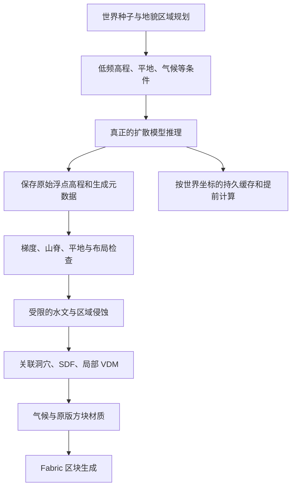

# 扩散基础地形：后续架构与验证路线

状态：研究设计，尚未实现。当前 Java 原型不包含扩散推理。

## 1. 数据流

不允许的回退：模型不可用时静默生成“椭圆孤山＋噪声”，或者展示程序化预览却让用户以为是扩散结果。模型未就绪应显式报告，保留已生成区域。

## 2. 首轮实际实验

1. 固定 Terrain Diffusion 提交、模型 revision、数据归一化和采样参数。
2. 所有依赖／模型／缓存进入本工作区，例如 `models/`、`runtime/`、`cache/`；首次初始化前设置相关模型缓存路径，避免默认写入用户目录。
3. 先导出未经侵蚀的扩散高程，在统一水平和垂直尺度下观察。预览明确标注“原始扩散”“条件图”“后处理”。
4. 比较官方 30 m 模型的自由生成、粗高程条件和局部修补能力。不要把 30 m 数据简单插值成 1 格就宣称得到米级岩柱。
5. 对四种地貌各做多个种子对照。若粗条件无法稳定区分峰林和柱群，收集针对性数据并尝试地貌条件微调。
6. 再加入轻度侵蚀，保留可回退的原始高程。与基础对比证明后处理在改进地貌，而不是冲平模型细节。

## 3. 需要拆分的职责

| 模块／类 | 单一职责 |
|---|---|
| RegionPlanner | 地貌区域范围、邻接、标志景观候选位置 |
| ConditionRasterizer | 将区域规则转换成条件图，不生成最终山体 |
| DiffusionBackend | 模型加载、推理、明确错误与版本信息 |
| TerrainDiffusionAdapter | 锁定版本的官方管线适配与通道／坐标转换 |
| DiffusionScheduler | 任务优先级、批处理、超时与取消 |
| TerrainTileStore | 持久缓存、哈希校验和崩溃恢复 |
| TerrainDerivatives | 梯度、Hessian、法线与多尺度分析 |
| LandformEvaluator | 平地比例、山脊连通、峰间距和标志景观检查 |
| ClimateModel | 当前气候及风、水汽条件 |
| RainfallModel | 地形降雨、雨影与有效径流输入 |
| DrainageSolver | 洼地、流向、汇流和跨区域边界 |
| ErosionProcess | 不同侵蚀实现的共同接口 |
| HydraulicErosion / TalusErosion / KarstWeathering | 各自过程与参数；不塞入一个大函数 |
| DensityComposer | 高程实体、三维结构与布尔合成 |
| CaveNetworkPlanner / CaveCarver | 洞室网络与空间挖空分别实现 |
| VdmPatchAdapter | VDM 坐标转换、几何有效性与体积转换 |
| BiomeClassifier / SurfacePalette | 群系选择与方块材质分别实现 |
| ChunkWriter | 将准备好的数据写入 Minecraft 区块 |
| PreviewExporter | 使用真实管线输出制作对照预览 |

这些是职责边界，不要求每个过程都在首版实现。核心原则：一个类不要同时处理模型下载、HTTP、侵蚀、方块填充和界面。

## 4. Minecraft 集成策略

初期候选：工作区内的本地 Python 推理进程 + Fabric 请求适配器，便于直接使用官方模型和修改条件；性能稳定后评估 ONNX／原生推理。

外部 Python 进程只是一种候选，不是已经决定的成品依赖。是否打包运行时、模型体积和目标设备要在模型实测后确定。首轮研究不额外安装环境或下载多 GB 权重。

### 缓存身份

至少包含：世界标识、世界种子、模型文件哈希、模型配置、算法版本、条件图版本、水平／垂直尺度、tile 坐标。不同世界不能共享可变的全局 seed；原 API 有切换 seed 接口，不适合直接供多个并发世界共享一个可变实例。

### 随机性与边界

- 随机噪声按全局坐标和世界种子确定；不能按“第几个请求”决定。
- 模型采样依赖邻域时，明确重叠、halo 与调度依赖；已提交区块不能因后来探索另一侧而改变。
- 同一后端应验证请求顺序一致性。不同 GPU／算子版本的逐位一致性不能预先保证，持久保存已提交生成结果。
- 河流与侵蚀需要比地貌区域更大的流域范围，跨边界交换高程和通量；不将每个方形 tile 四边当海岸。
- 边界须检查高程、坡度、河床／水面和三维连通；只用线性混合无法同时解决所有问题。

## 5. 数据候选与缺口

- Copernicus DEM：全球参考，主要是 DSM；植被与建筑影响、许可与预处理需核对。官方页面已保存。
- ETOPO / WorldClim：Terrain Diffusion 官方粗尺度训练流程的参考。
- 高分辨率 DEM／LiDAR：对窄峰、石柱、断崖更关键。USGS 3DEP 页面本轮请求受阻；只列为候选，不声称下载到数据。
- 桂林与张家界：本轮没有找到已核实、可直接拿来训练的成套开放高分辨率专用数据集。不能承诺零数据微调即可复现。
- 三维扫描／人工地质建模：可补充悬挑和洞穴训练资产；常规 DEM 无法恢复不可见背面与内部。

训练划分按地理区域分离，避免相邻裁块同时出现在训练和测试集。程序化合成可补充控制标签，但若合成数据都是规则圆锥，模型也可能学回同样的问题。

## 6. 效果验收

### 基础身份

- 能提供模型名称／revision、权重哈希、采样种子、条件图与未经后处理的高程。
- 推理不可用时明确失败；不以程序化形状假装模型输出。

### 用户关注的审美

- 平原孤山：大片连通平原，多样孤立山体；峰形和山脚不重复。
- 裂谷：非对称、分段、宽窄变化；避免等宽直槽与固定周期波形。
- 桂林：峰林、峰丛与盆地交错；不以等间距锥体代替。
- 张家界：柱群、峰墙、残台互相转换；避免均匀插柱。
- 每个实际区域的标志景观必须经最终地形检测确认，不能只因“规划过一个锚点”就算通过。

### 数值与工程

- 种子与探索顺序复现；区域边界连续；有限且受控的生成延迟。
- 降雨与出流平衡、河床连通、沉积质量账本、洞穴有效宽度。
- 记录地形生成耗时与缓存命中；不能把纯 Java 原型的速度当扩散模型速度。

## 7. 当前暂停点

已完成本轮资料收集和路线纠正。后续首先实施真实扩散基线与条件实验；不继续打磨旧原型的椭圆孤山公式。
